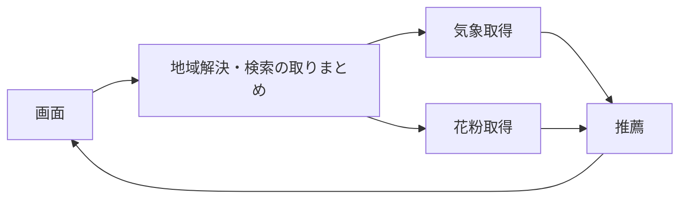

# 花粉対策ナビ（MQTT除外版）

地域と日付を選び、気象・花粉情報に基づく外出対策を表示するアプリです。
このブランチでは、画面・地域解決・気象取得・花粉取得・推薦を1台のPC内のPython関数でつなぎます。

## 起動

リポジトリのルートで実行します。既存の仮想環境がある場合は、その環境を使います。

Mac:

```bash
source env/bin/activate
python -m pip install -r requirements.txt
python run_all.py
```

Windows PowerShell:

```powershell
.\env\Scripts\python.exe -m pip install -r requirements.txt
.\env\Scripts\python.exe run_all.py
```

仮想環境がない場合は、最初に `python3 -m venv env`（Windowsは `py -m venv env`）で作成します。

通常はブラウザーで `http://localhost:8501` を開きます。地域・日付・任意のアレルギーを指定し、「対策を調べる」を押します。終了は起動したターミナルでCtrl+Cです。画面用の子プロセスも停止します。

`run_all.py` はこの版でも起動の入口です。Streamlitを1つ起動し、その中で各担当の処理を呼び出します。別々のPCで担当プログラムを常駐させる構成ではありません。

## 設定

`.env` がまだない場合だけ、`.env.example` を `.env` にコピーします。既存の `.env` は上書きしません。

```dotenv
GOOGLE_POLLEN_API_KEY=
```

Google Pollen APIの有効なキーを設定すると実際の花粉データを取得します。空欄の場合は従来どおりダミー値を使い、画面にも「ダミー」と表示します。取得に失敗した場合を、自動的にダミー成功へ置き換える動作はしません。

Broker・Topic・接続ポート・MQTT認証の設定は不要です。Mosquitto、HiveMQ、EMQX、Pahoも使用しません。以前の個人設定ファイルに残る通信設定は参照しません。

## 処理の流れ



| 担当 | ファイル | 処理 |
| --- | --- | --- |
| 起動 | run_all.py | 画面の起動、終了コードの返却、Ctrl+Cでの終了 |
| 画面 | UI/app.py | 国内/海外地域、日付、アレルギー入力、検索と結果表示 |
| 取りまとめ | server/server.py | 入力確認、座標解決、気象/花粉取得の呼び出し、推薦結果の返却 |
| 地域解決 | common/locations.py | 国内自治体・海外都市の座標を調べる |
| 気象 | weather/get_weather_data.py | Open-Meteoの日別情報を取得・整形する |
| 花粉 | pollen/get_pollen_data.py | Google Pollenを取得・整形する。キーなし時はダミー値を返す |
| 推薦用の変換 | recommend/service.py | 取得済み情報を推薦関数の入力へ変換する |
| 推薦 | recommend/recommend.py | 既存ルールでレベル・持ち物・行動・理由を決める |

検索ごとにrequest_idを発行し、地域・日付・入力条件を一緒に渡します。日付は `date`（YYYY-MM-DD）です。画面の入力を変更しただけでは再取得せず、検索ボタンで取得します。

地域検索・天気・実際の花粉APIへのHTTPS接続にはインターネットが必要です。取得できない場合は画面にエラーを返します。花粉の指数が提供されない日は「判定不可」とし、取得できた天気を表示する既存の処理を維持しています。

通常の推薦はルール方式です。既存のGeminiアダプターは保持していますが、この起動経路でGeminiを自動利用する変更はしていません。

## テスト

リポジトリのルートで実行します。

```bash
python -m pytest -q
```

地域・データ整形・推薦・入力異常・API失敗・同時検索・画面操作・run_all.pyの起動/終了を確認します。外部APIは固定応答へ置き換え、実在する個人情報やAPIキーを送信しません。

画面からの検索はPahoを読み込めない条件でも試験します。起動試験では本物のStreamlitをローカルで起動し、HTTP応答と終了後のポート解放を確認します。WindowsではPOSIX信号による起動終了試験だけをスキップします。

実APIの現在の到達性やデータ提供状況、Windows実機での操作は、これらの固定応答テストとは別に確認してください。
