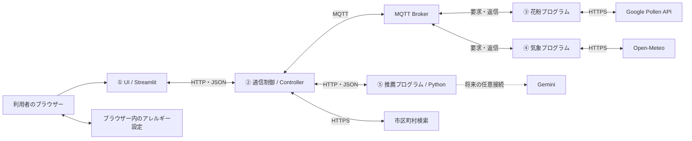

# 花粉対策ナビ アプリ設計書

作成日：2026-10-18（日本時間）／作成：池田

状態：ここまでの本人との決定を反映したレビュー用設計書。担当間の接続方法などの技術提案は、班・先生の承認済み仕様とは区別する。アプリの実装・結合動作を証明する文書ではない。

## 1. 目的と設計の範囲

日本国内の地域と対象日を選ぶと、その日の花粉・気象情報から、外出時の対策レベル、持ち物・行動、理由を確認できるWebアプリを作る。自身のアレルギーを設定した場合は、その種類を重点的に扱い、他の花粉情報も参考として表示する。

本書は要件、全体構成、画面、データ、通信、判定、設定保存、例外処理、完成確認をまとめたものである。過去のログイン・DB・履歴を前提とする設計に代わる、今回の初回開発範囲を示す。

### 1.1 決定済みの利用方針

| 項目 | 方針 |
| --- | --- |
| 対象地域 | 日本国内。現在地取得と、都道府県→市区町村の選択を用意する |
| 対象情報 | 日別の花粉・気象情報。時間帯別の花粉予報とは表示しない |
| アレルギー設定 | 任意。未設定を「アレルギーなし」と解釈しない |
| 設定の保存 | 同じブラウザーで次回も使えるように保存・復元する |
| レベル判定 | Pythonが花粉指数から決める。天気・風ではレベルを加算しない |
| 個別化 | 設定した種類を重点化。他の種類も参考表示する |
| 複数設定 | 各種類の指数を表示し、有効な設定種UPIの最大値を基準にする |
| 一部欠測 | 取得できた設定種による暫定レベルと、判定に含めなかった種類を表示する |
| 全設定種が未取得 | 個人向けレベルは判定不可。地域の参考情報とは分ける |
| 通信 | 初回からMQTTを使う |
| 開発・実演の希望 | まず1台で動かす。複数PC化も可能な境界にする。授業の最終実演条件は別途確認する |
| ログイン・DB・履歴 | 初回範囲には設けない。結果は検索時に取得する |
| Gemini | 将来、任意で対策文を生成する。レベル判定はPythonのまま |

### 1.2 今回設けない機能

利用者アカウント、ログイン画面、クラウドへの個人設定保存、結果履歴の一覧・再表示、結果保存用DB、端末間同期、自動追跡、時間帯別の花粉予報は設けない。既存のDBやテーブルを削除する作業は、本設計書の作成に含まない。

画面に現在表示している結果を一時的に持つことは必要だが、これを「履歴閲覧機能」とは扱わない。再訪問時は設定だけを復元し、検索ボタンから情報を取り直す。

## 2. 講義条件との対応

| 資料で確認した条件 | 今回の対応 | 根拠・留保 |
| --- | --- | --- |
| Python 3を使う | 主な処理をPythonで実装する | 第1週スライド42 |
| ネットアクセス・通信・解析/推薦・表示 | 気象/花粉取得→通信→判定→表示の経路を作る | Notion「1講義」ノート |
| 複数サイトの情報を組み合わせる | Open-MeteoとGoogle Pollen APIを使う | 第2週105、109。「2つ以上」はレポート記述例にあり、独立した課題原文の最低数指定は未確認 |
| 一つのプログラムにまとめず協調動作 | 5担当を独立して起動できる構成を提案する | 第2週113。5人の図では5プログラム |
| 担当部分のプロトコルを毎週記述 | 入出力、順序、期限、未受信・異常時の動作を記録する | 第1週52〜54、第3週171 |
| MQTTの使用で加点 | 気象・花粉の要求/返信にMQTTを使用する | 第2週112。加点数・獲得済みかは未確認 |
| 設計・試験・使い方の説明 | 本書、担当別設計、試験記録、利用手順を用意する | 第3週151、155〜156 |

第2週資料は「分散環境で動作」を示し、「1講義」ノートには一人1ノード・各自PC上での実装という記録がある。したがって、1台での結合確認を開発の出発点とすることと、1台のみで授業の完成条件を満たすことは分ける。最終的に複数PCでの実演が必要か、先生へ確認する。

ログイン、DB、結果履歴、Gemini、現在地取得について、今回確認した講義資料に個別の必須指定・加点保証は見つからなかった。

## 3. 全体構成と担当

### 3.1 今回の構成提案

講義の協調動作を確認しやすいよう、UI・通信制御・気象・花粉・推薦を独立した5つのPythonプログラムにする案を推奨する。MQTT Brokerは、その5つとは別の通信基盤であり、担当者の自作プログラム数に数えない。

UIとController、Controllerと推薦の境界はHTTP/JSONで接続する案とする。気象・花粉はMQTTを使う。これによりアレルギー設定を気象・花粉向けMQTTへ送らず、既存の推薦関数も独立したプログラムから呼べる。

**この分離とHTTP接続は2026-10-18に本人が実装計画を承認した。班・先生の最終承認とは区別する。** 以前の「UI・Controller・推薦を同一プロセス内の関数で呼ぶ案」は少ないプロセスで動かせる一方、担当ごとの独立した協調動作を示しにくいため、講義向け構成として見直す。独立化する範囲と実装ライブラリは接続担当間で確認する。



| ブロック | 担当の記録 | 入力 | 処理・出力 |
| --- | --- | --- | --- |
| ① UI | 馬場 | 利用者の操作、ブラウザーの保存設定 | 地域/日付/アレルギー設定を送信し、結果・欠測・失敗を表示する |
| ② 通信制御 | 村岡さん | UI要求、各担当の返信 | 入力検証、位置解決、検索ID、MQTT要求、集約、推薦呼出し、最終返却 |
| ③ 花粉 | 大高 | 座標、対象日、検索ID | Google Pollenを取得し、植物/分類ごとのUPIと取得状況を返信する |
| ④ 気象 | 池田 | 座標、対象日、検索ID | 日別天気コード、日最大風速、補助情報を返信する |
| ⑤ 推薦 | 高野 | 正規化済み気象/花粉、今回のアレルギー設定 | レベル、対策、理由、個別化の成否を返す。将来のAI接続もここに置く |

担当の業務は既存の分担を維持する。通信担当者の氏名表記は班で統一する。統合の取りまとめは通信担当、各接続の確認は受渡し双方で行う案とする。

### 3.2 接続方法の比較

| 案 | 特徴 | 本書での位置付け |
| --- | --- | --- |
| 同一プロセスで関数呼出し | 起動が少なく、単体の結合を始めやすい | 以前の技術案。5担当の独立動作の確認が必要 |
| 5プログラム、HTTPとMQTTを併用 | 各担当を独立起動し、後からPCを分けやすい | 今回の推奨案。HTTP境界の班内確認が必要 |
| 全境界をMQTTに統一 | 通信を一種類にできる | UI/推薦のTopicや個人設定の配送設計が増えるため、今回は選ばない案 |

## 4. 機能要件と画面

| ID | 機能 | 完成したと判断する条件 |
| --- | --- | --- |
| FR-01 | 市区町村選択 | 都道府県を選ぶと、その都道府県の市区町村を選べる。都道府県変更時は市区町村を未選択に戻す |
| FR-02 | 現在地取得 | ボタンで位置取得を要求し、拒否・失敗時も検索に切り替えられる |
| FR-03 | 日付指定 | 日別の対象日をISO日付として送信できる。初期案は今日・明日・明後日 |
| FR-04 | 任意のアレルギー設定 | 複数種類を選べ、未設定でも利用できる |
| FR-05 | 設定の保存・復元・削除 | 同じブラウザー・アクセス先で次回復元でき、設定を消せる |
| FR-06 | 気象・花粉の取得 | 同じ検索ID・位置・対象日で両データを取得・照合する |
| FR-07 | 個別/一般レベル判定 | 6章の判定・欠測規則に従う |
| FR-08 | 結果表示 | レベル、花粉、天気、風、対策、理由、取得日時、出典を表示する |
| FR-09 | 失敗・一部取得の表示 | 判定不可や暫定結果を通常成功と区別し、再検索できる |

画面は一つのメイン画面を基本とし、設定をサイドバーまたは同画面内にまとめる。ログイン画面・履歴画面・アカウント登録画面は作らない。

利用順序は「設定復元→地域の指定→日付の選択→任意設定の確認→検索→結果確認」とする。都道府県・市区町村の選択と予報の取得は別の操作にする。候補の先頭や、サーバーの現在地を勝手に採用しない。

結果領域は、対象地域/日付、対策レベル、設定種の個別情報、その他の花粉の参考情報、天気/風、対策一覧、理由、取得日時/出典の順とする。情報がない種類には「未取得」「対応外」「対応確認中」を表示し、0に置き換えない。

画面状態は「設定読込中」「入力待ち」「地域検索中」「予報取得中」「通常結果」「一部取得」「取得失敗」を区別する。予報取得中は多重送信を防ぎ、チェック項目を触るたびにAPIを呼ばない。結果と入力条件が変わった場合は、その結果の対象条件が分かる表示にする。

## 5. 地域・日付・外部API

### 5.1 地域の決定

地域選択は国土地理院の`muni.js`にある国内自治体の名前とコードを使う。初回に一覧を取得し、都道府県→市区町村の順に選ぶ。都道府県変更時は市区町村を未選択に戻し、現在地取得時は両方の欄へ反映する。予報は取得ボタンを押すまで要求しない。候補IDは`gsi:13101`のように5桁自治体コードから作り、Controllerが一覧と照合する。代表座標は地理院地図の住所検索で、自治体の正式表示名に一致する地点から得る。提供サービスの変更・停止時はエラーを示し、別地域を採用しない。

現在地はブラウザーのGeolocationでボタンを押したときだけ取得する。**本人の追加指示により、市区町村への逆変換は必須**とする。国土地理院の逆ジオコーディングで得た自治体コードを国内自治体一覧と照合し、その自治体の代表地点を両APIに渡す。生のGPS座標から直接予報を取らず、表示名を市区町村名とする。自治体全域の平均値や地点ごとの実測値を表すものではない。

座標の大きな四角形による確認は事前チェックに限り、国内の確定は自治体コードの解決と照合による。海上・国外・解決失敗は都道府県・市区町村の手動選択へ案内する。位置は保存しない。ブラウザーの位置権限とlocalhost/HTTPS環境が必要であり、本人の実際のGPS権限・精度は本人の環境で確認する。

Controllerが確定した同じ代表座標・`location_id`を両取得プログラムへ渡す。

### 5.2 日付と単位

内部の日付は`YYYY-MM-DD`、画面の日付候補は日本時間で作る。初期案は今日・明日・明後日だが、地域とAPIの実際の提供範囲を優先し、未提供の日を他の日の値で埋めない。

気象は`Asia/Tokyo`の日別値とし、風速は対象日の地上10mの日最大風速、単位はm/sとする。API要求で`wind_speed_unit=ms`を指定する。日平均気温・湿度は補助情報であり、それだけの欠測で花粉レベルを判定不可にしない。

Google Pollenの`dailyInfo[].date`は公式仕様上UTCの日付である。初期案では同じ暦日の気象と花粉を表示し、花粉がUTC基準であることを明示する。両者が完全に同じ24時間を表すとは記載しない。日本時間での日付境界、深夜の対象日、要求日数と実応答の対応は統合前に確認する。

### 5.3 APIアダプター

| 取得先 | 要求 | 正規化して返す情報 |
| --- | --- | --- |
| Open-Meteo Forecast | 確定座標、対象日、日別項目、`timezone=Asia/Tokyo`、`wind_speed_unit=ms` | 天気コード、日最大風速、日平均気温/湿度、提供元日付、単位 |
| Google Pollen | 確定座標、必要な日数、言語指定 | `dailyInfo`から対象日を選び、分類/植物、UPI、対応状況、提供元日付を返す |

日本の公式対応表にはイネ科・スギ・ヒノキが記載されている。一方、個別地域・対象日に各植物の有効指数が返るか、提供元コードをどの内部コードへ対応させるかは実応答で確認する。`TREE`をスギ、`GRASS`を特定のカモガヤと同一視しない。

選択肢のマスターは表示名、内部コード、対応する分類/植物、対応状況を持つ。既存UIにあるブタクサ・シラカバ等を残す場合も、日本で取得できると装わず、対応外の設定として扱えるようにする。初回に表示する全選択肢は班で確定する。

## 6. Pythonによる判定と対策

### 6.1 レベル

| 有効UPI | アプリの表示レベル |
| --- | --- |
| 0〜1 | 低 |
| 2〜3 | 中 |
| 4 | 高 |
| 5 | 非常に高い |

上表は本人と確認したアプリ内の表示区分であり、医学的な個人の発症リスクを保証する尺度ではない。UPIは0〜5の整数として検証し、数値0と未取得を区別する。風速や、設定種と一致したことによるレベル加点は行わない。

### 6.2 判定対象と欠測

| 条件 | レベルの基準 | 表示 |
| --- | --- | --- |
| 設定なし | 地域の有効な分類UPIの最大値 | 一般の花粉情報。個人のアレルギーなしとは言わない |
| 設定種がすべて取得可能 | 設定種の有効UPIの最大値 | 個人向けレベルと各設定種の情報 |
| 設定種の一部だけ取得可能 | 取得できた設定種の最大値 | 暫定レベル、対象種、未取得/対応外の種類を明示 |
| 設定種がすべて取得不可 | 個人向けの基準なし | 個人向けは判定不可。地域情報は参考として別表示 |
| 花粉に有効値がない | 基準なし | レベル判定不可。気象があれば気象情報は表示 |
| 気象だけ欠測 | 花粉の基準を維持 | レベルは表示し、気象に基づく対策が不足する旨を表示 |

未設定時の地域分類UPIが欠け、植物別UPIだけある場合は、地域全体の代表値へ黙って代用しない。植物別情報を参考表示し、一般レベルは判定不可とする案を採る。

取得状況の内部値は、`available`（有効UPIあり）、`missing`（対応は確認済みだが対象データなし）、`unsupported`（提供対象外と確認済み）、`unknown`（対応関係をまだ確認できない）とする。`available`以外のUPIは`null`に統一する。

### 6.3 対策と理由

Pythonが「花粉レベルに対応する基本対策」と「取得できた気象に応じた対策」を組み合わせ、重複を除いた`items`と、判断に使った事実を説明する`reason`を作る。

対策マスターは、識別子、対象レベル、気象条件、表示文、理由文、優先順、根拠を持つ設計とする。雨・風の条件で何を追加するか、風速のどの値を閾値にするか、具体的な対策文は未確定であり、班で確認してから正式な値を入れる。以前の風速によるレベル加算を再利用しない。

欠測時は、その情報を根拠に対策を作らない。レベル判定不可の場合も、取得済みの参考情報や気象情報は表示できるが、個人向け判定が成功したようには説明しない。

対策マスター未確定の結合試験では、授業の実演用の対策文を使い、`meta.advice_status=draft`と画面の注意書きで区別する。`meta.is_mock`は気象・花粉のデータ由来を示す値とし、架空予報ならtrue、実取得ならfalseとする。本番用の医学的根拠や班の承認を得た文章として扱わない。

## 7. アレルギー設定の保存

ブラウザーの`localStorage`を保存先の第一候補とする。ログインもサーバーDBも必要としない。保存キーの案は`pollen-navi.settings.v1`とする。

次は形式を示す架空例であり、本人のアレルギー情報ではない。

```json
{
  "version": 1,
  "allergy_state": "selected",
  "allergies": ["sugi", "hinoki"]
}
```

`allergy_state`は`selected`または`unknown`。`selected`では許可された内部コードが1件以上、`unknown`では空配列とする。「未登録/わからない」と具体的な種類を同時選択させない。

起動時に保存設定を読み、型・版・コードを検証してUIへ復元する。読込完了前に空の設定で自動検索・自動上書きしない。不正な保存データは未設定へ戻し、スギなどを勝手に選ばない。

変更時は保存し、削除操作ではアプリ用のキーだけを消す。保存できない場合も今回の入力で検索でき、次回の復元はできないことを表示する。保存の成否と予報取得の成否は別に扱う。

保存されるのは設定だけである。位置情報、検索結果、対策本文、APIキーは入れない。保存先は同じブラウザープロファイル・同じオリジンに限られ、別端末には同期されない。データ削除やプライベート利用等で設定が残らない場合がある。Streamlitとブラウザー保存をつなぐ方法は実機確認する。

## 8. 通信インターフェース案

以下は新構成に合わせた`schema_version=1.2-draft`の提案である。旧`1.0`・`1.1-draft`からの自動互換は仮定せず、担当間で確認してから実装する。JSONはUTF-8、欠測は`null`、キーは小文字の`date`・`pollen`・`wind`に統一する。

### 8.1 UIとController

| 操作 | HTTP案 | 内容 |
| --- | --- | --- |
| 地域一覧の取得 | `GET /api/v1/locations/options` | 全件を自治体コード順に返す。画面は都道府県で絞り、同一セッションで再利用する |
| 名前検索（互換用） | `GET /api/v1/locations?query=...` | 国内候補を返す既存経路。現在の画面は使用しない |
| 現在地の自治体解決 | `POST /api/v1/locations/current` | 緯度・経度を受け、国内市区町村と代表地点を返す |
| 予報・推薦 | `POST /api/v1/recommendations` | 地域入力、日付、今回の設定を受け、最終レスポンスを返す |
| 稼働確認 | `GET /health` | プログラム自身の稼働を返す。外部APIへの接続成功とは区別する |

候補取得のレスポンスは`schema_version`、`candidates`、`errors`を持つ。候補の各要素は`candidate_id`、`name`、`prefecture`、`country_code`を持ち、0件は`candidates=[]`、正常時は`errors=[]`とする。候補IDから元の位置へ解決できるかを、提供元の仕様と実データで確認する。

選択した地域の入力形式例（通信の`mode`は互換性のため`search`を維持）：

```json
{
  "schema_version": "1.2-draft",
  "location_input": {"mode": "search", "candidate_id": "gsi:13101"},
  "date": "2026-10-18",
  "allergy_state": "selected",
  "allergies": ["sugi", "hinoki"]
}
```

現在地の場合は`location_input`を次の形式にする。座標は架空例である。

```json
{
  "mode": "current",
  "latitude": 35.6812,
  "longitude": 139.7671,
  "accuracy_m": 100,
  "captured_at": "2026-10-18T00:00:00Z"
}
```

Controllerが入口でUUIDの`request_id`を発行し、日付、座標範囲、国、設定の型とコードを検証する。検索の入力は一度固定し、途中のUI変更を進行中の検索へ混ぜない。アカウントID、認証トークン、DB保存状態は要求しない。

正常・一部取得はHTTP 200と本文の`status`で区別する。入力不正は400、上流通信失敗は502、上流待機期限超過は504を基本とし、同じJSON形式で理由を返す。通信自体が成立しない場合はUIが接続失敗を表示する。今回の実装はPython標準ライブラリのThreadingHTTPServerとrequestsを用いる。班内での接続確認は別途行う。

### 8.2 Controllerと気象・花粉：MQTT

| 用途 | Topic |
| --- | --- |
| 気象要求 | `project_exercises/v1/weather/request` |
| 花粉要求 | `project_exercises/v1/pollen/request` |
| 気象返信 | `project_exercises/v1/{controller_id}/weather/result` |
| 花粉返信 | `project_exercises/v1/{controller_id}/pollen/result` |

共通設定案はQoS 1、retain false。Topic中の`v1`はTopic系列の識別であり、本文の`schema_version`も必ず照合する。初回のController IDは`demo-local`、各Client IDは役割名と起動ごとのUUIDで重複を避ける。

要求の架空例：

```json
{
  "schema_version": "1.2-draft",
  "request_id": "00000000-0000-4000-8000-000000000001",
  "controller_id": "demo-local",
  "location_id": "gsi:13101",
  "latitude": 35.6812,
  "longitude": 139.7671,
  "date": "2026-10-18",
  "expires_at": "2026-10-18T00:00:35Z",
  "is_mock": true
}
```

気象・花粉への要求にアレルギー設定やAPIキーは含めない。各Workerが自身のAPI用設定を使う。

Worker返信は、共通ヘッダーとして`schema_version`、`request_id`、`controller_id`、`location_id`、`date`、`source`、`status`、`data`、`errors`、`warnings`、`fetched_at`、`is_mock`を持つ。`source`は`weather`または`pollen`。Workerの`status`は`success`または`error`とし、取得内容の不足は`warnings`と項目の`availability`で伝える。`fetched_at`はAPI取得完了のUTC時刻であり、提供元の予報更新日時ではない。失敗時はnullにする。

| Worker | 成功時の`data` | 欠測・失敗 |
| --- | --- | --- |
| 気象 | `provider_date`、`timezone`、`weather_code`、`wind_speed_max`、`temperature_mean`、`humidity_mean`、`units` | 天気・風の片方でも有効なら成功と警告。両方なしはerror。補助情報だけの不足も警告にする |
| 花粉 | `provider_date`、`provider_timezone`、`region_code`、`types`配列、`plants`配列 | 各要素に内部コード、提供元コード、名前、UPI、availability。有効なUPIが一つもなければerror |

エラー時は`data=null`、`errors`に`source`・`code`・`message`を持つ要素を入れる。成功時は`errors=[]`、警告なしは`warnings=[]`。異常な型や範囲の値を有効値として返さない。

受渡し順序は「返信Topicの購読完了→要求送信→両Workerの並行取得→返信照合→推薦」とする。Controllerは検索ID、位置ID、対象日、送信元、版を確認し、重複・期限切れ・終了済み・別検索の返信を採用しない。同じWorkerへの同じIDの重複要求は処理を二重化せず、一時的な処理状態で除外する。

管理する検索状態はメモリー上の実行管理であり、利用者向け履歴でもDBでもない。要求終了・期限切れ後に破棄する。Worker側の重複排除記録も上限付き・期限付きのメモリー管理とし、結果本文を永続保存しない。

### 8.3 Controllerと推薦

推奨案は推薦プログラムの`POST /api/v1/evaluate`。本文には`schema_version`、`request_id`、確定済みの`location`・`date`、`weather`・`pollen`、それぞれの取得失敗情報、`allergy_state`・`allergies`、`is_mock`を入れる。失敗した取得元のデータは`null`とする。

推薦プログラムは正規化済みのデータで判定し、9章の最終レスポンスと同じ形式で`schema_version`、`request_id`、`status`、`data`、`details`、`meta`、`errors`、`warnings`を返す。ControllerがIDと対象条件を再照合してUIへ返す。気象・花粉が両方取得不能なら、推薦を呼ばずControllerがerrorを返す。推薦内の既存Python関数は、この入口から利用する構成にする。

## 9. 最終レスポンスと画面表示

`status`は`success`・`partial`・`error`。`data`は表示の基本8項目、`details`は種類別の構造化情報、`meta`は判定状態などを持つ。画面は説明文を解析して種類別データを復元せず、`details`を使う。

| 要素 | 意味 |
| --- | --- |
| `data.location`・`date` | 今回の対象地域・日付 |
| `data.level` | 低/中/高/非常に高い、またはnull。nullは画面で「判定不可」 |
| `data.pollen`・`weather`・`wind` | 人が読む要約。未取得を明記する |
| `data.items` | 重複を除いた持ち物・行動の文字列配列 |
| `data.reason` | 判定に使った情報・対象種・不足を説明する文字列 |
| `details` | location、weather、pollen、regional_referenceの構造化情報 |
| `meta` | 判定範囲、個別化状態、暫定か、対象種、未取得種、ルール版、取得日時、タイムゾーン、架空データか |

次は契約の確認用の架空成功例。対策文も検証用である。

```json
{
  "schema_version": "1.2-draft",
  "request_id": "00000000-0000-4000-8000-000000000001",
  "status": "success",
  "data": {
    "location": "架空の対象地域",
    "date": "2026-10-18",
    "level": "高",
    "pollen": "設定種の最大UPI 4",
    "weather": "晴れ",
    "wind": "日最大 3.0 m/s",
    "items": ["結合試験用の対策文"],
    "reason": "スギ4・ヒノキ1を取得し、設定種の最大UPI 4から判定した。"
  },
  "details": {
    "location": {"location_id": "gsi:13101", "latitude": 35.6812, "longitude": 139.7671, "country_code": "JP"},
    "weather": {"provider_date": "2026-10-18", "timezone": "Asia/Tokyo", "weather_code": 0, "wind_speed_max": 3.0, "temperature_mean": 20.0, "humidity_mean": 60, "units": {"wind_speed_max": "m/s", "temperature_mean": "C", "humidity_mean": "%"}},
    "pollen": {
      "provider_date": "2026-10-18", "provider_timezone": "UTC", "region_code": "JP",
      "types": [{"code": "TREE", "provider_code": "TREE", "name": "樹木", "upi": 4, "availability": "available"}],
      "plants": [
        {"code": "sugi", "provider_code": "MOCK_CEDAR", "name": "スギ", "upi": 4, "availability": "available"},
        {"code": "hinoki", "provider_code": "MOCK_CYPRESS", "name": "ヒノキ", "upi": 1, "availability": "available"}
      ]
    },
    "regional_reference": {"upi": 4, "level": "高", "basis": "types"}
  },
  "errors": [],
  "warnings": [],
  "meta": {
    "is_mock": true,
    "assessment_scope": "personal",
    "personalization_status": "complete",
    "is_provisional": false,
    "assessed_allergies": ["sugi", "hinoki"],
    "unavailable_allergies": [],
    "recommendation_source": "rule",
    "rule_version": "demo-0.2",
    "fetched_at": "2026-10-18T00:00:00Z",
    "timezone": "Asia/Tokyo",
    "pollen_timezone": "UTC"
  }
}
```

`provider_code`が`MOCK_`で始まる上記植物コードは架空値であり、Googleの実コードではない。

| 状況 | 最終status | レベル・表示 |
| --- | --- | --- |
| 必要な情報が揃う | success | 通常の一般/個人向け結果 |
| 設定種の一部が未取得 | partial | 取得できた設定種のレベル。`is_provisional=true`、個別化はpartial |
| 全設定種が未取得だが参考情報あり | partial | `level=null`、個別化はunavailable。参考レベルを個人向けレベル欄へ入れない |
| 花粉のみ取得 | partial | 花粉からのレベルは表示可能。気象欠測だけで暫定レベルにはしない |
| 気象のみ取得 | partial | `level=null`、花粉取得不可を明示 |
| 両方取得不可・入力不正・推薦停止 | error | `data=null`。再検索方法とエラー理由を表示 |
| 任意AIだけ失敗 | 他の判定状態を維持 | Pythonの対策へ戻し、警告を付ける |
| 設定のブラウザー保存だけ失敗 | 予報の判定状態を維持 | UIが保存失敗を別表示する |

`personalization_status`はcomplete/partial/unavailable/general/not_evaluated。`assessment_scope`はpersonal/regional/none。`is_provisional`は設定種の一部に基づく暫定判定を表し、全設定種が未取得で判定自体がない場合はfalseとする。未設定の一般結果はgeneral・regionalとする。`meta.fetched_at`は採用したWorker取得完了時刻のうち遅い時刻とし、両方失敗ならnull。画面で必要な場合は各取得元の時刻も`details`へ添える。

errorの架空例：

```json
{
  "schema_version": "1.2-draft",
  "request_id": "00000000-0000-4000-8000-000000000002",
  "status": "error",
  "data": null,
  "details": null,
  "errors": [{"source": "mqtt", "code": "MQTT_UNAVAILABLE", "message": "取得プログラムへ接続できませんでした。"}],
  "warnings": [],
  "meta": {
    "is_mock": true,
    "assessment_scope": "none",
    "personalization_status": "not_evaluated",
    "is_provisional": false,
    "assessed_allergies": [],
    "unavailable_allergies": [],
    "recommendation_source": "none",
    "rule_version": "demo-0.2",
    "fetched_at": null,
    "timezone": "Asia/Tokyo",
    "pollen_timezone": "UTC"
  }
}
```

成功でもDBに保存したという意味は持たない。旧案の`persistence_status`、`user_id`、`auth_context`は本契約では要求しない。

## 10. 待機期限と異常時の動作

以下の秒数は実測前の初期提案である。従来の「全体20秒」と混同せず、20秒は気象・花粉の並行待機区間として扱う。

| 区間 | 初期案 | 期限超過時 |
| --- | --- | --- |
| 地域検索/位置解決 | 5秒 | 候補検索の再試行・手動指定へ案内 |
| MQTT接続/購読準備 | 5秒 | 取得開始失敗として通知 |
| Workerの外部API | 8秒 | 取得元と理由を付けてerror返信 |
| 気象・花粉の並行待機 | 最大20秒 | 届いた情報でpartial、両方なしはerror |
| 推薦プログラム | 3秒（AIなし） | 推薦取得失敗。入力データの成功とは区別 |
| Controller全体 | 最大35秒（AIなし） | 処理を終了し遅延返信を無視 |
| UIのController待機 | 最大55秒（AIなし） | 接続/期限超過を表示し再検索可能にする |

全体期限を各段階で残り時間へ反映し、段階ごとの上限を積み重ねて無制限に待たない。自動の無限再試行は行わず、利用者が再検索できるようにする。壊れたJSON、未知の版、範囲外の値、別の検索の返信は採用せず、内部記録には理由を残す。

診断用の記録は検索ID・役割・状態・経過時間・エラーコードを中心とし、APIキー、精密な現在地、アレルギー設定や結果本文を常時出力しない。診断記録は利用者向け履歴とは別である。

## 11. 起動・設定・複数PC

初回の開発用接続案は、Broker `127.0.0.1:1883`、Controller `127.0.0.1:8000`、推薦 `127.0.0.1:8001`とする。Streamlitは別ポートで起動する。今回のローカル開発BrokerはaMQTTを採用し、一括起動に含める。外部Brokerへ切替える入口も用意した。

5プログラム案の場合、Brokerを含め6プロセスを起動する。順序はBroker→気象/花粉/推薦→Controller→UI。接続・購読の完了を確認してから検索する。HTTPサーバーのフレームワークと実際の起動コマンドは、入口の実装後に担当間で統一する。既存ファイル名があるだけで、この順序で動くとは判断しない。

必要な設定はBroker接続先、Controller ID、推薦URL、Controller URL、Google Pollen API用の認証情報、HTTPの待機期限である。API認証情報は担当プログラムの環境設定へ置き、Gitや画面へ出さない。DB用設定・利用者ログイン・Geminiキーを、AIなしの起動条件にしない。

複数PCに分けるときは、Broker/HTTP接続先を到達可能なアドレスへ変更する。各PCの`127.0.0.1`は各自のPC自身を指す。Brokerの接続制御、HTTPの受信範囲、同一ネットワークの接続可否を試験する。ブラウザーを別PCで開く場合は、現在地取得のsecure context条件も確認する。無認証のままインターネットへ公開する構成は本書の範囲外である。

## 12. 将来のGemini接続

初期は`AI_ADVICE_ENABLED=false`とし、Pythonのルールだけで動作させる。将来有効にする場合は、推薦プログラムから確定したレベル・取得済み事実・基本対策を渡し、対策文だけを生成させる。

AIにレベルの変更、欠測値の補完、未取得種の飛散の断定をさせない。名前、位置の生座標、検索ID、認証情報は送らず、必要な事実に絞る。AIの文章は内容・形式を検査し、失敗・不正・矛盾時は元のPythonの対策へ戻す。`recommendation_source`でrule/geminiを区別する。

任意AIの待機は8秒、AI有効時の推薦待機は11秒、Controller全体は45秒、UI待機は50秒を初期案とする。モデル、利用枠、具体的なプロンプト、文章検査は追加時に確認する。部分取得時のAI呼出しは初期案では無効とする。

## 13. 現行コードとの差分

以下は2026-10-18の実装前に確認した差分の記録である。実装後の状態と検証結果は実装・検証記録を参照する。

| 現行箇所 | 今回の設計への変更点 |
| --- | --- |
| `UI/app.py` | 推薦関数の直接importとダミー代替から、Controller接続・正規レスポンス表示へ。地域候補/現在地/設定保存を追加し、既定のスギ選択と根拠のない「多い」表示を改める |
| `server/server.py` | DB保存を必須とする流れから、入力検証→MQTT取得→集約→推薦→返却へ。DB設定なしでも起動できるようにする |
| `server/recieve.py` | 旧固定Topic/キーから、版・ID・位置・日付を照合する受信処理へ統合する |
| 気象の取得・送信 | 固定座標/1回送信から要求購読へ。日付・位置、天気コード、m/s、欠測を扱う |
| 花粉の取得・送信 | `daily_index`参照から公式の`dailyInfo`構造へ。設定ファイルへの依存と実コード対応を確認する |
| `recommend/recommend.py` | 花粉UPI基準に統一し、風速や設定一致によるレベル加算を外す。設定種の欠測・個人判定不可を扱う |
| 推薦の起動入口 | 独立プログラム案を採る場合はHTTP入口を用意し、既存の判定関数を内部から呼ぶ |
| 依存関係・README | DBを必須としない起動手順、必要ライブラリ、5プログラムの動作確認手順へ更新する |

作業中の既存変更はそのまま維持する。本書作成ではアプリのファイル、実DB、Broker、外部API設定を変更していない。

## 14. テスト設計と完成条件

以下は実施予定の試験であり、合格済みではない。

| ID | 確認すること | 期待結果 |
| --- | --- | --- |
| AT-01 | ログイン・DB設定・AIキーなしで起動 | 入力・検索・ルール結果表示ができる |
| AT-02 | 都道府県・市区町村を選び、都道府県を変更 | 同名市を区別でき、変更時は古い市区町村を解除する。選択だけでは予報を要求しない |
| AT-03 | 現在地を許可/拒否/取得失敗 | 許可時は都道府県と市区町村を反映。拒否/失敗時も手動選択で利用できる |
| AT-04 | 国内判定不可・対象外座標・無効日付 | 勝手に既定地域や別日へ変えず、理由を表示する |
| AT-05 | 未設定で検索 | 一般情報を表示し、「アレルギーなし」と断定しない |
| AT-06 | 設定種を複数指定 | 各種類を表示し、最大の有効UPIを個人向け基準にする |
| AT-07 | UPIの境界0/1/2/3/4/5と異常値 | 表の区分どおり。null、負数、6、文字、真偽値を有効UPIにしない |
| AT-08 | 設定種の一部が未取得 | 暫定レベルと、含めなかった種類を表示する |
| AT-09 | 設定種がすべて未取得・地域情報のみあり | 個人向けは判定不可。参考レベルと混ぜない |
| AT-10 | UPI 0と未取得を与える | 0は有効値、未取得は判定に含めない |
| AT-11 | 気象のみ失敗/花粉のみ失敗/両方失敗 | 9章のpartial/errorどおり。気象欠測で花粉レベルを変えない |
| AT-12 | 同じ花粉に異なる風速を与える | 対策・理由は変えられるがレベルは同じ |
| AT-13 | 設定を保存して再読込・再訪問・変更・削除 | 正常復元し、不正値/保存拒否でも今回の検索は使える |
| AT-14 | ブラウザーを閉じた後、再訪問 | 設定のみ復元し、結果履歴は出さない。検索操作で再取得する |
| AT-15 | 設定読込中・チェック操作・検索の連打 | 不要なAPI取得や空設定での自動上書きを起こさない |
| AT-16 | MQTTの購読前送信、切断、重複、遅延、別ID/日付/位置 | 購読後に要求し、不正返信を採用せず期限内に終了する |
| AT-17 | 2つのタブ/利用セッションで同時検索 | 実行中の条件と結果が混ざらない |
| AT-18 | 気象と花粉の日付・単位・実コード | m/s、JST/UTC、種類の対応を確認でき、別日の値へ黙って置換しない |
| AT-19 | 固定JSON→MQTT→実API→UIの順で結合 | 各段階の証拠を残す。架空結果と実取得を区別する |
| AT-20 | 5担当を別プログラムとして起動/停止 | 通信で協調動作し、停止した担当を正しく検出する |
| AT-21 | 複数PCの接続 | 必要と確認された場合に実施。宛先変更後も同じ契約で動作する |
| AT-22 | Geminiを将来有効化し、成功/失敗/不正応答を与える | レベルを変えず、失敗時はPythonの対策を表示する |

試験記録には入力、目的、操作、期待値、実際の結果、判定、担当、実施日を残す。正常系だけでなく、担当単位と全体の両方を確認する。

初回の機能的な完成はAT-01〜20を必要な実データ確認も含め満たすこととする案である。授業で複数PCが必要ならAT-21も必須となる。任意AIのAT-22は初回の完成条件から外す。具体的な対策マスターが未確定のまま、実利用向けに完成したとは報告しない。

## 15. 実装前に残る確認事項

| ID | 確認事項 | 確認する相手・方法 |
| --- | --- | --- |
| Q-01 | 最終実演で複数PCが必要か。5担当の独立化の扱い | 先生・講義条件との照合 |
| Q-02 | 本人承認済みの5プログラム・HTTP/MQTT構成について、班内の担当間接続を確認 | 接続する両担当で確認 |
| Q-03 | 具体的な対策文、気象の条件・風速閾値、根拠、優先順 | 推薦担当と班でレビュー |
| Q-04 | 日本の植物コード、選択肢、対象日・UTC/JST境界 | 花粉担当の実応答で確認 |
| Q-05 | 日本語の市区町村検索品質、現在地の国内判定方法 | 位置入力の実機・実データ確認 |
| Q-06 | 実装したブラウザー保存/Geolocationの本人環境での再確認 | UI担当が復元・削除・拒否・再訪問を確認 |
| Q-07 | ローカルBroker導入後の複数PCの経路・授業実演条件の確認 | 通信担当が接続試験 |
| Q-08 | 各担当の接続確認日、全体テスト日、報告書の取りまとめ | 班で設定。未提供の日付は作らない |

上記は未確認事項であり、既存の本人決定を取り消すものではない。ログイン・DB・結果履歴を追加する判断とは切り離す。

## 16. 利用手順・出典・文書管理

利用手順は、アプリを開く→保存された設定を確認/必要なら変更→現在地または市区町村を指定→日付を選択→検索→レベルと対策を確認、の順とする。設定を消したいときは「アレルギー設定を削除」を使う。失敗時は案内に従って地域を指定し直すか再検索する。

表示には取得日時、気象と花粉の提供元、データ不足と架空データの区別を含める。Google Pollenの表示・帰属は公式方針に従い、天気と花粉のどちらの情報かが分かるようにする。地図の表示は初回の必須機能に含めない。

### 根拠

- 本人との会話：日本国内、現在地/市区町村検索、任意のアレルギー設定・同一ブラウザー保存、Pythonによるレベル、天気/風は対策内容、任意の将来Gemini、初回からMQTT、ログイン/DB/結果履歴を設けない範囲。
- 講義PDF：第1週`Prj26-01-02H-1.pdf`、第2週`Prj26-03-04HH.pdf`、第3週`Prj26-05-06.pdf`。根拠スライドは2章を参照。
- [グループ用](https://app.notion.com/p/3e923366af2a800eb836fa61390b08fb)、[1講義](https://app.notion.com/p/3e923366af2a80c1943ff5c43fe9a6ff)、[役割分担](https://app.notion.com/p/3e923366af2a8032a256eb6374d44acc)、[既存プロトコル](https://app.notion.com/p/3fb23366af2a80a39ccdf843333d9a84)、[旧上流工程](https://app.notion.com/p/3f923366af2a80ac889cf4b24d8f057a)。旧資料と本書が異なる場合、今回の初回範囲は本書を優先する。技術案の承認状態は別に判断する。
- [Open-Meteo Forecast](https://open-meteo.com/en/docs)、[Geocoding](https://open-meteo.com/en/docs/geocoding-api)：日別値、単位、タイムゾーン、日本国内候補の検索仕様。
- [Google Pollen応答仕様](https://developers.google.com/maps/documentation/pollen/reference/rest/v1/forecast/lookup)、[対応地域](https://developers.google.com/maps/documentation/pollen/coverage)、[表示・帰属方針](https://developers.google.com/maps/documentation/pollen/policies)：日付、分類/植物、国内対応、表示上の条件。
- [localStorage](https://developer.mozilla.org/en-US/docs/Web/API/Window/localStorage)、[Geolocation](https://developer.mozilla.org/en-US/docs/Web/API/Geolocation/getCurrentPosition)：同一オリジンでの保存と、位置取得の権限・環境条件。

外部仕様の確認日：2026-10-18。API・位置取得・ブラウザー保存の実動作確認とは区別する。

### 変更記録

v0.2：最新の利用方針へ統合。ログイン、クラウドDB、結果履歴を初回範囲から外し、アレルギー設定だけをブラウザーに保存する。花粉指数による判定と将来のGeminiを整理。講義向けの独立5プログラム案、通信契約案、完成条件、未確認事項を追記した。

旧設計のSQL・認証テスト・履歴保存条件は過去の提案として扱い、今回実行しない。本書を作成・保存したことと、班の承認・アプリ実装・テスト合格・授業条件の充足は別である。

### 2026-10-18 実装への反映

本人承認のMQTT/API結合計画に従い、種類別判定、位置解決、独立5プログラム、ブラウザー保存、一括起動を実装した。起動は`python run.py --demo`（架空予報）または`python run.py`（実API）。ローカル開発BrokerはaMQTTを使い、127.0.0.1のみに待受する。UIのHTTP待機は位置解決と各通信の待ち時間を考慮して55秒とした。詳細な実装済み・検証済み・未確認の区分は`docs/implementation/2026-10-18-integration.md`を参照する。本文の初期提案・試験一覧を、そのまま全項目合格済みと解釈しない。


### 2026-10-19 地域入力の変更

本人の依頼により、地域の自由入力を都道府県→市区町村の選択へ変更した。取得用の自治体ID・MQTT契約・元の配色とカード配置は維持。全体158件成功。実ブラウザーのデモ・検証用座標による確認は実装記録を参照する。
